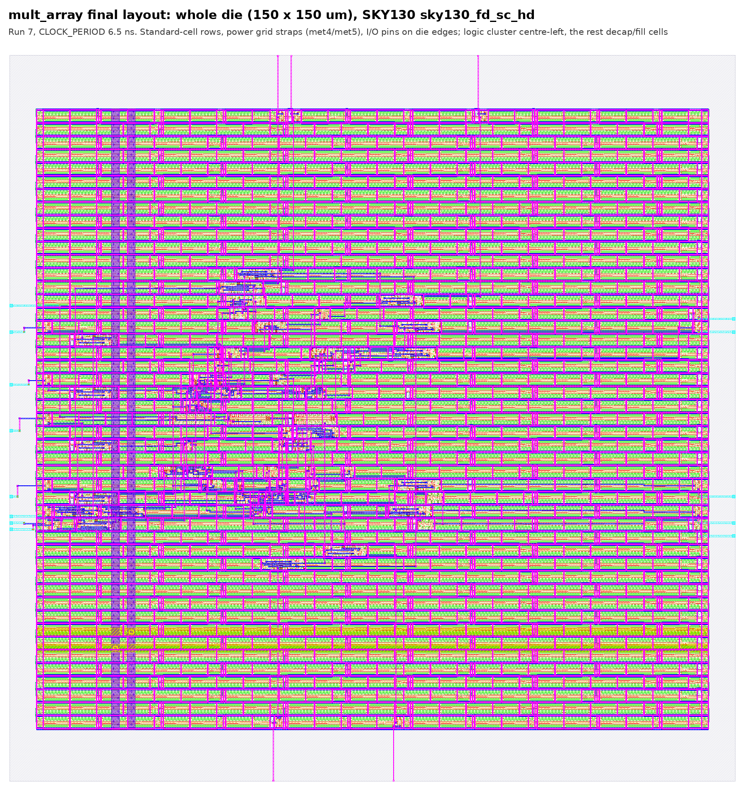
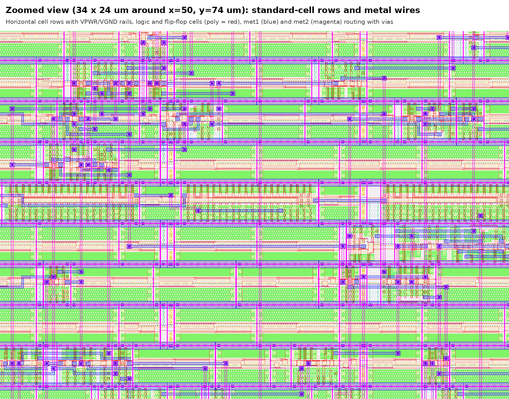

\newpage

# Overview

We designed a registered 4-bit × 4-bit unsigned array multiplier (8-bit product) in Verilog, verified it
exhaustively, and took it through the full open-source flow on the SkyWater SKY130 130 nm process with the
`sky130_fd_sc_hd` standard-cell library:

* RTL design and simulation (Icarus Verilog, GTKWave);
* logic synthesis (Yosys);
* static timing analysis (OpenSTA);
* place and route to a GDSII layout (LibreLane with OpenROAD, Magic, KLayout and Netgen).

All tools ran from the IIC-OSIC-TOOLS Docker image (`hpretl/iic-osic-tools:latest`). The exact command for
every step, in order, is in `README.md`.

| Tool | Version | Used in |
|---|---|---|
| Icarus Verilog | 14.0 (devel) | A, B |
| GTKWave | 3.3.116 | A |
| Yosys | 0.69 | B |
| OpenSTA | 3.1.0 | C |
| LibreLane (with OpenROAD, Magic, KLayout, Netgen) | 3.1.0.dev3 (Magic 8.3, KLayout 0.30, Netgen 1.5) | D |
| PDK | SKY130A, `sky130_fd_sc_hd` | all |

**Summary of results**

| Part | Key result |
|---|---|
| A | RTL simulation `PASS: 256 vectors checked, 0 errors`; error test `FAIL: 256 vectors checked, 95 errors` |
| B | 63 cells (16 flip-flops + 47 logic), 740.71 µm², flip-flops 54.05 % of area; netlist simulation PASS |
| C | WNS 7.396 ns at 10 ns, Tmin 2.604 ns, Fmax 384.0 MHz; critical path `a_r[1]` → `p[6]` |
| D | CLOCK_PERIOD 6.5 ns after 7 runs; 0 DRC, 0 LVS, setup slack +0.085 ns; post-route Fmax 155.9 MHz |

# Part A: RTL Design and Verification

## Design

`rtl/full_adder.v` is a dataflow full adder with two `assign` statements:
`sum = a ^ b ^ cin` and `cout = (a & b) | (a & cin) | (b & cin)`.

`rtl/mult_array.v` (module `mult_array`, ports `clk`, `rst_n`, `a[3:0]`, `b[3:0]`, `p[7:0]`) works as follows:

1. It registers `a` and `b` into `a_r` and `b_r` on every rising clock edge.
2. It builds the 16 partial-product AND gates, $pp_i[j] = a\_r[j] \wedge b\_r[i]$.
3. It adds the partial products with three rows of 4 explicitly instantiated `full_adder`s (12 instances),
   wired exactly as the "Exact connections" table of the assignment specifies.
4. It registers the 8-bit result into `p`.

The `*` operator is not used. All 16 flip-flops have an asynchronous active-low reset (`rst_n`). An input
applied before clock edge 1 reaches `p` at edge 2, so the latency is 2 clock cycles.

{ width=92% }

## Testbench and simulation

`tb/tb_mult.v` (module `tb_mult`) works as follows:

* It generates a 10 ns clock and holds `rst_n` low for the first 2 cycles.
* It applies all 256 combinations of `a` and `b` on the falling edge, then waits two rising edges (the
  2-cycle latency).
* It checks `p` 4 ns after the second edge against `a * b`. The `*` operator is used only in the testbench.
* It prints a line for every mismatch, then one summary line, and writes `mult.vcd`.

```
$ iverilog -g2012 -o sim tb/tb_mult.v rtl/full_adder.v rtl/mult_array.v
$ vvp sim
PASS: 256 vectors checked, 0 errors
```

**Error-injection test (task 6).** With `sum` in `full_adder.v` temporarily changed to `a ^ b`, the same
testbench reports:

```
MISMATCH at t=1069 ns: a=3 b=3 p=5 expected=9
...
FAIL: 256 vectors checked, 95 errors
```

The change was then undone, and the testbench prints PASS again. Only 95 of the 256 products fail: the bug
only shows when a carry-in of 1 actually reaches a full adder. Products such as $x \times 0$, $x \times 1$ or
$x \times 2$ never produce an internal carry, so they stay correct. This shows the value of an exhaustive
testbench.

## Hand-worked example (task 5)

We used Vansh Jaiswal's roll number, **2024102013**. Its last digit is 3, so **A = 3 + 5 = 8** and **B = 7**.

```
               1 0 0 0       A = 8
             x 0 1 1 1       B = 7
       ---------------
               1 0 0 0       pp0 = A AND b0 (b0 = 1)
             1 0 0 0         pp1 = A AND b1 (b1 = 1), shifted 1
           1 0 0 0           pp2 = A AND b2 (b2 = 1), shifted 2
         0 0 0 0             pp3 = A AND b3 (b3 = 0), shifted 3
       ---------------
       0 0 1 1 1 0 0 0       P = 56
```

The same multiplication traced through the array (Section 2 equations). Each row's values match the
simulated internal signals bit for bit:

| Row | Adds | Sum s / carry c[4] | Product bit | Passed down |
|---|---|---|---|---|
| 0 | pp0 = 1000 | (no adders) | p[0] = 0 | r0 = 0100 |
| 1 | pp1 1000 + r0 0100 | s1 = 1100, c1[4] = 0 | p[1] = 0 | r1 = 0110 |
| 2 | pp2 1000 + r1 0110 | s2 = 1110, c2[4] = 0 | p[2] = 0 | r2 = 0111 |
| 3 | pp3 0000 + r2 0111 | s3 = 0111, c3[4] = 0 | p[3] = 1 | p[7:4] = 0011 |

P = 0011 1000₂ = **56** = 8 × 7.

## Waveform

{ width=100% }

# Part B: Logic Synthesis with Yosys

`synth/synth.tcl` runs the seven required steps:

1. `read_verilog`
2. `synth -top mult_array -flatten`
3. `dfflibmap -liberty $lib`
4. `abc -liberty $lib`
5. `opt_clean -purge`
6. `tee -o synth/mult_array_stat.rpt stat -liberty $lib`
7. `write_verilog -noattr synth/mult_array_netlist.v`

Here `$lib` is the typical-corner Liberty file `sky130_fd_sc_hd__tt_025C_1v80.lib`.

| Metric | Value |
|---|---|
| Total number of cells | 63 |
| Number of flip-flops | 16 (`sky130_fd_sc_hd__dfrtp_1`) |
| Total cell area (µm²) | 740.710 |
| Flip-flop area (µm²) | 16 × 25.024 = 400.384 |
| Flip-flop area (% of total) | 54.05 % |
| The 3 most-used cell types and their counts | `dfrtp_1` × 16, `nand2_1` × 8, `a21oi_1` × 6 |
| Netlist simulation result | `PASS: 256 vectors checked, 0 errors` |

The remaining 33 cells are:
`xnor2_1` × 4, `maj3_1` × 3, `nand3_1` × 3, `xor2_1` × 3, `and2_0` × 2, `clkinv_1` × 2,
`lpflow_isobufsrc_1` × 2, `xnor3_1` × 2, and 12 cell types used once.

**Netlist simulation.** The synthesized netlist was simulated with the SKY130 cell models
(`-DFUNCTIONAL -DUNIT_DELAY=#1`) and the same testbench, and passes all 256 vectors.

The first netlist run printed mismatches in which every product appeared one vector late. The cause was the
testbench, not the design. With `UNIT_DELAY` the flip-flop models change `Q` 1 ns after the clock edge, and
the testbench originally sampled `p` at exactly that moment. The testbench now samples 4 ns after the edge;
the RTL still passes, and the error-injection test still fails.

# Part C: Static Timing Analysis with OpenSTA

`sta/sta.tcl` performs the seven required steps at the typical corner (`tt_025C_1v80`):

1. read the Liberty file;
2. read and link the netlist;
3. create a clock of period T on `clk`;
4. set a 1.0 ns input delay (all inputs except `clk`);
5. set a 1.0 ns output delay;
6. `report_worst_slack -max`;
7. save `report_checks -path_delay max -digits 3` to `sta/mult_array_timing.rpt`.

At **T = 10 ns** the worst setup slack is **7.396 ns** (OpenSTA prints 7.40 at 2 digits). Therefore:

* $T_{min} = T - WNS = 10 - 7.396 = 2.604$ ns
* $F_{max} = 1000 / T_{min} = 384.0$ MHz

Rerunning at **T = 2.60 ns** (Tmin rounded to 0.01 ns) gives a slack of **−0.004 ns ≈ 0**, and 2.61 ns gives
+0.006 ns. With an ideal clock the path delay does not depend on T, so the slack is exactly T − 2.604 ns.

| Metric | Value |
|---|---|
| Worst slack at T = 10 ns (ns) | 7.396 |
| Tmin (ns) | 2.604 (≈ 2.60) |
| Fmax (MHz) | 384.0 |
| Slack at T = Tmin (ns) | −0.004 (≈ 0) |
| Critical path start point | `a_r[1]` input register (CLK pin) |
| Critical path end point | `p[6]` output register (D pin) |
| Number of cells on the critical path | 9 (launch flip-flop + 8 logic gates) |
| Latency (ns) = 2 × Tmin | 5.208 |
| Throughput (million results per second) | 384.0 |

## Cells on the critical path

Each net on the path was matched to an RTL signal by comparing its truth table over all 256 values of
(`a_r`, `b_r`) with the equations of Section 2.

| # | Cell | Delay (ns) | Arrival (ns) | Signal computed | Part of |
|---|---|---:|---:|---|---|
| 0 | `dfrtp_1` (CLK→Q) | 0.398 | 0.398 | `a_r[1]` | input register |
| 1 | `clkinv_1` | 0.074 | 0.472 | NOT `a_r[1]` | AND gates |
| 2 | `o311ai_0` | 0.348 | 0.820 | merged partial-product / row-1 logic | AND gates + fa1_1 |
| 3 | `a21oi_1` | 0.172 | 0.992 | c2[1] | fa2_0 carry |
| 4 | `maj3_1` | 0.381 | 1.373 | c2[2] | fa2_1 carry |
| 5 | `xnor2_1` | 0.160 | 1.534 | NOT s2[2] | fa2_2 sum |
| 6 | `maj3_1` | 0.385 | 1.918 | NOT c3[2] | fa3_1 carry |
| 7 | `maj3_1` | 0.377 | 2.295 | NOT c3[3] | fa3_2 carry |
| 8 | `xnor3_1` | 0.175 | 2.471 | s3[3] → `p[6]` | fa3_3 sum |

Path delay: 0.398 (clock-to-Q) + 2.073 (logic) + 0.134 (setup) = 2.605 ns ≈ Tmin.

**Comparison with the 2N estimate.** The path passes through **7 full-adder stages**:
fa1_1 → fa2_0 → fa2_1 → fa2_2 → fa3_1 → fa3_2 → fa3_3. That is, along row 2's carry chain, down through
s2[2], then along row 3's carry chain to the top sum bit. This agrees well with the estimate of about
2N = 8 full-adder delays.

6 of the 8 gates compute a full-adder carry or sum directly. Each stage costs only one gate (about 0.30 ns),
because the path needs only the carry *or* the sum of each adder, not both.

# Part D: Physical Design with LibreLane

`pnr/config.json` sets:

| Setting | Value |
|---|---|
| DESIGN_NAME | `mult_array` |
| VERILOG_FILES | the two RTL files |
| CLOCK_PORT | `clk` |
| FP_SIZING | `absolute` |
| DIE_AREA | [0, 0, 150, 150] |
| CLOCK_PERIOD | started at 1.2 × Tmin = 3.125 ns, rounded up to 3.5 ns |

The flow was run with `librelane config.json`. After each failing run, CLOCK_PERIOD was increased by 0.5 ns:

| Run | CLOCK_PERIOD (ns) | Worst setup slack (ns) | Typical-corner slack (ns) | DRC | LVS | Result |
|---:|---:|---:|---:|---:|---:|---|
| 1 | 3.5 | −2.132 | +0.547 | 0 | 0 | fail |
| 2 | 4.0 | −1.632 | +1.047 | 0 | 0 | fail |
| 3 | 4.5 | −1.142 | +1.551 | 0 | 0 | fail |
| 4 | 5.0 | −0.642 | +2.052 | 0 | 0 | fail |
| 5 | 5.5 | −0.142 | +2.552 | 0 | 0 | fail |
| 6 | 6.0 | −0.064 | +2.943 | 0 | 0 | fail |
| **7** | **6.5** | **+0.085** | **+3.293** | **0** | **0** | **pass** |

DRC and LVS were clean in every run. Only setup timing failed, and only in the slow corner
(`max_ss_100C_1v60`: slow transistors, 100 °C, 1.60 V). LibreLane signs off in 9 corners and reports the
worst one as `setup__ws`. The typical corner used in Part C passed from the first run.

Runs 1–5 gained almost exactly 0.5 ns per step. Run 6 gained only 0.08 ns, because LibreLane re-synthesizes
and re-sizes the design for each target period. With a looser clock it picks smaller, slower gates.

| Metric | Value |
|---|---|
| CLOCK_PERIOD used (ns) | 6.5 |
| Number of runs needed | 7 |
| Core area (µm²) | 17 759.5 (die 150 × 150 µm = 22 500 µm²) |
| Cells after synthesis (from Part B) | 63 |
| Cells after place and route | 1 901 |
| Kinds of cells added | decap 1 296, fill 270, tap 245, I/O buffers 17, clock-tree buffers 3, fanout buffers 2 |
| Wirelength (µm) | 2 405 |
| Setup slack (ns) | +0.085 |
| Post-route Fmax (MHz) | 1000 / (6.5 − 0.085) = 155.9 |
| Fmax from Part C (MHz) | 384.0 |
| DRC errors | 0 (Magic 0, KLayout 0, router 0) |
| LVS errors | 0 |

Other signoff results:

* hold slack +0.124 ns;
* no antenna or power-grid violations;
* Magic and KLayout GDS streams identical (XOR difference 0);
* cell utilisation 7.0 %.

The flow reported 11 max-slew warnings, all in the slow corner and all on the asynchronous reset net
(0.761 ns transition against a 0.75 ns limit). The typical corner has none, and the flow completed successfully.

## Cells after place and route

| Kind | Cells | Count |
|---|---|---:|
| Tap | `tapvpwrvgnd_1` | 245 |
| Decap | `decap_3/4/6/8/12` | 1 296 |
| Fill | `fill_1`, `fill_2` | 270 |
| Clock-tree buffers | `clkbuf_16` | 3 |
| I/O buffers | `buf_2` (9 inputs, 8 outputs) | 17 |
| Fanout buffers | `clkdlybuf4s50_1` (reset net) | 2 |
| Design cells | `dfrtp_1` 16, logic 49, `inv_1` 3 | 68 |
| **Total** | | **1 901** |

LibreLane runs its own synthesis script, which produced 68 design cells instead of the 63 of Part B.

## Layout

{ width=82% }

{ width=100% }

# Answers to the Questions

## Q1. How many cells did synthesis produce for the logic, and why is it not simply 16 + 12? {.unnumbered}

Synthesis produced 63 − 16 = **47 logic cells** (340.3 µm²), compared with 16 AND gates + 12 full adders =
28 blocks. The two do not match because ABC maps the logic onto the cells of `sky130_fd_sc_hd`, not onto
our modules. After `-flatten`, the full-adder boundaries disappear and the logic is optimised as a whole.

* **Full adders become several cells.** ABC does not use the library's multi-output full-adder cell
  (`fa_1`). Each adder is built from a sum gate (`xor`/`xnor`, sometimes `xor3`/`xnor3`) plus a carry gate
  (`maj3`, or AOI/OAI/NAND logic). This pushes the count up.
* **Other logic merges into fewer cells.** Many AND gates are absorbed into complex gates (`o311ai`,
  `a21oi`, `nand2`). The adders in column 0 have `cin = 0` and become half adders, and the constant 0 fed
  into row 1 removes logic. This pulls the count down.
* **Inverters appear** (`clkinv_1` × 2) to fix signal polarity.

The result is a netlist of small library gates that is logically identical to the RTL. We verified this by
simulating it on all 256 inputs.

## Q2. What is the critical path, how many cells are on it, and how does it compare with 2N? {.unnumbered}

The critical path starts at the **`a_r[1]` input register** and ends at the **`p[6]` output register**.
It has **9 cells**: the launch flip-flop plus 8 gates (`clkinv`, `o311ai`, `a21oi`, `maj3`, `xnor2`,
`maj3`, `maj3`, `xnor3`), with an arrival time of 2.471 ns and a setup time of 0.134 ns at the typical corner.

Matching each net to the RTL shows that the path crosses **7 full-adder stages**: it runs along row 2's
carry chain, drops through s2[2] into row 3, and then along row 3's carry chain to s3[3]. This is close to
the estimate of about 2N = 8 full-adder delays, which is only an approximation of the longest
chain. Each adder stage costs only one gate (about 0.30 ns), because the path uses only the carry or only
the sum of each adder.

## Q3. What percentage of the total cell area is flip-flops, and why is it so large? {.unnumbered}

The flip-flops take **400.384 of 740.710 µm² = 54.05 %** of the area, even though they are only 16 of the
63 cells. Each `dfrtp_1` is a master-slave flip-flop with asynchronous reset. At 25.02 µm² it is the
largest cell in the design: about 6.7 times a `nand2_1` (3.75 µm²), and larger than any combinational cell
here (the biggest is `xor3_1` at 23.77 µm²).

The design is also very small. A 4-bit array has only 28 adder/AND blocks, while registering both inputs
and the output needs 4N = 16 flip-flops. Register count grows linearly with N, but the array grows as N².
For an 8-bit multiplier we would expect 32 flip-flops (800.8 µm²) against roughly 120 adder/AND blocks
(≈ 1 460 µm² at our 12.15 µm² per block), so the flip-flop share would fall to about 35 %.

## Q4. Why is the post-route Fmax lower than in Part C? Which cells did the flow add, and why? {.unnumbered}

Post-route Fmax is **155.9 MHz** (6.5 ns period, +0.085 ns slack), against **384.0 MHz** in Part C. Part C
was an idealised analysis, and four effects lower the real number:

1. **Corner.** Part C used only the typical corner. LibreLane signs off in the slow corner (100 °C,
   1.60 V), where cells are about twice as slow. In the typical corner alone, the routed design would
   reach 1000 / (6.5 − 3.293) = 311.8 MHz.
2. **Wires.** Routed nets add resistance and capacitance, which increases gate delay and slew.
3. **Clock.** Part C had an ideal clock. After clock tree synthesis, the clock passes through two levels of
   `clkbuf_16` (about 0.5 ns of latency, with skew between flip-flops), and the flow adds 0.25 ns of
   clock uncertainty.
4. **Netlist.** LibreLane re-synthesizes for the target period and uses smaller, slower gates when the
   clock is loose.

The flow added 1 833 cells, taking the design from 68 to 1 901 cells:

* **Tap cells** (`tapvpwrvgnd_1`, 245) tie the n-well to VPWR and the substrate to VGND at regular
  intervals in every row, which prevents latch-up.
* **Decap cells** (`decap_*`, 1 296) are capacitors between VPWR and VGND. They supply charge locally when
  gates switch, reducing supply noise and IR drop.
* **Fill cells** (`fill_1/2`, 270) fill the remaining gaps, so the wells, implants and power rails are
  continuous along each row as DRC requires.
* **Buffers:**
  * 3 `clkbuf_16` form the clock tree, delivering `clk` to all 16 flip-flops with low skew;
  * 17 `buf_2` I/O buffers isolate the 9 input and 8 output pins from the internal logic;
  * 2 fanout buffers split the high-fanout reset net.

## Q5. What do DRC and LVS verify, and why must both pass before manufacture? {.unnumbered}

**DRC (design rule check)** verifies that the layout geometry obeys the foundry's manufacturing rules:
minimum widths and spacings of every layer, enclosures of contacts and vias, overlaps, and density.
**LVS (layout versus schematic)** extracts the transistors and their connections from the drawn layout and
checks that they form exactly the same circuit as the gate-level netlist: the same devices, the same nets
and the same pins.

The two checks catch different failures:

* A DRC violation means the chip may not be manufacturable, or will have shorts and opens that lower yield.
* An LVS mismatch means a perfectly manufacturable chip would implement the wrong circuit.

A layout can pass one check and fail the other, so both must pass. Our final layout has **0 DRC errors**
(Magic, KLayout and the router) and **0 LVS errors** (Netgen).

## Q6. How would the number of full adders and the critical path change for an 8-bit multiplier? {.unnumbered}

Using the formulas from Section 2, with N = 8 instead of N = 4:

* **Full adders:** N(N − 1) = 8 × 7 = **56** (instead of 4 × 3 = 12), 4.7 times as many.
  AND gates: N² = 64 (instead of 16). Flip-flops: 4N = 32 (instead of 16).
* **Critical path:** about 2N = **16 full-adder delays** (instead of 8), so roughly **twice** as long.
  The delay grows linearly with N, while the hardware grows as N².

With our measured numbers (0.398 ns clock-to-Q, about 0.296 ns per full-adder stage, 0.134 ns setup):

* 8-bit: $T_{min} \approx 0.398 + 16 \times 0.296 + 0.134 = 5.27$ ns, so $F_{max} \approx 190$ MHz at the
  typical corner.
* 4-bit (for comparison): 2.604 ns and 384.0 MHz.
